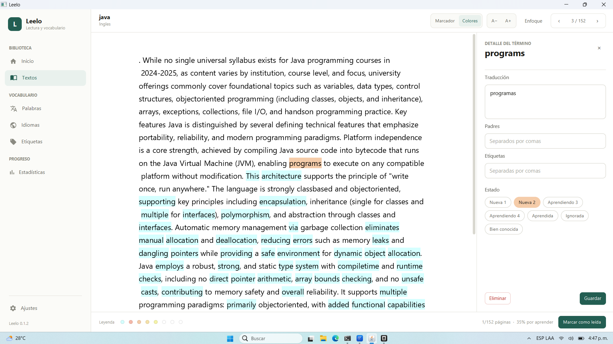

# Leelo – Reading Application to Track Vocabulary

A desktop application to improve reading skills and language learning.

Leelo is an project built around the same ideas as
[Lute v3](https://github.com/jzohrab/lute_v3): you read texts in a foreign
language, the words are highlighted according to what you already know, and you
build your vocabulary as you go.

## Features

### Reading

- Texts are split into **pages** that are comfortable to read. The split can
  happen on paragraphs or on sentences, and the size of a page is configurable.
- Every word that is still being learned is highlighted with the **colour of
  its status** (unknown and stages 1 to 4), using the same palette as the
  default theme of Lute. Learned, ignored and well known words stay as plain
  text, so the words that still need attention are the ones that stand out.
- **Multi-word terms** are recognised: when a longer term covers a shorter
  one, the longest one wins and the hidden part is not shown twice.
- Clicking a word opens its details: translation, pronunciation, tags, parents
  and image, together with the buttons that change its status.
- The words of the page that you do not know yet are added to your vocabulary
  when the page is opened, and they can all be marked as known at once.
- **Bookmarks** point at the pages you want to come back to.
- The text is shown in a **centred column** under a single slim header, with only
  the page navigation and the reading options; the **focus mode** hides
  everything but the text.

### Vocabulary

- Terms have a **status**, a translation, a pronunciation, tags, parents and an
  optional image.
- A term can **follow its parent**: when it has a single parent, the two share
  their status.
- The list can be filtered by language, by status and by the presence of
  parents, and several terms can be changed at once.
- Terms are **imported and exported as CSV**, using the same format as Lute, so
  the word lists can be moved between the two applications.

### Languages

- A language defines **how its texts are tokenised**: the characters that form
  a word, the characters that end a sentence, the abbreviations that do not,
  and the substitutions that are applied to the text.
- Three analysers are available: space delimited languages, Turkish and
  Classical Chinese.
- Languages can have **dictionaries**, used to look up a word or a sentence.

### Statistics

- The number of words read per language, for the day, the week, the month, the
  year and in total.
- The **reading streak**, that is the number of consecutive days on which you
  read something.
- The **progress of a book**: the share of the words that are still unknown,
  calculated from the pages around the one being read.

### Settings

- The current language, whether the words are coloured, the size of the text and
  the number of pages sampled for the statistics.
- The **keyboard shortcuts** of the reading screen are configurable; the
  defaults follow the ones of Lute. Double-click a shortcut in the table to
  change it.

## Contributing

See [CONTRIBUTING.md](CONTRIBUTING.md) for the requirements, the development
setup, the tests and a tour of the code.

## Origin and acknowledgements

Leelo started as a personal project inspired by [Lute v3](https://github.com/jzohrab/lute_v3),
the language-learning tool created by Jeff Zohrab. Its approach to reading and
vocabulary was the main reference for this application: page splitting and
page sizes, term statuses and their colours, multi-word term matching,
configurable reading shortcuts and the CSV term format are all based on ideas
from Lute. Some of these features are deliberate ports of Lute's behaviour;
others are independent implementations written for Leelo.

All credit for the original
ideas goes to Lute and its author. Lute v3 is distributed under the MIT
license; its original copyright and license belong to jzohrab.

## License

This project is under the [MIT license](https://opensource.org/licenses/MIT).
